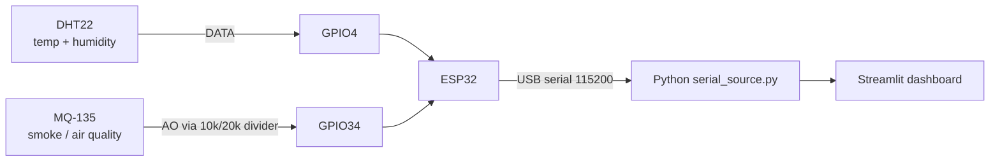

# Early Wildfire Detection and Analysis using ML

Educational prototype. Indian satellite fire points (NASA FIRMS VIIRS) joined with weather (Open-Meteo) to estimate fire intensity, shown in a Streamlit dashboard and fed live by an ESP32 sensor unit. **Not an official forecast and not a safety device.**

> **FRP (Fire Radiative Power, MW) is a satellite intensity proxy. It is not burned area in hectares.**

## Status

| Part | State |
|---|---|
| Datasets in repo (`data/raw`) | done |
| Slides (`docs/EL_Phase1_Wildfire.pptx`) | done |
| Serial parser + ESP32 sketch (`src/serial_source.py`, `hardware/`) | written, parser unit-tested, sketch not yet flashed |
| FIRMS cleaning + satellite-only FRP model | implemented; weather not yet included |
| Weather join and dashboard | next (Software steps below) |
| Hardware build and integration | after the model works |

## Repository layout

```
data/raw/        FIRMS VIIRS zips (tracked); extracted CSVs are git-ignored
data/samples/    one-location Open-Meteo hourly sample (RH only)
data/            firms_india_raw.csv (local, ignored), india_fires_weather.csv (output)
src/             app.py  data_prep.py  features.py  model_io.py  train_model.py  serial_source.py
hardware/        esp32_sensor/esp32_sensor.ino
tests/           pytest tests
evidence/        screenshots, plots, photos for the report
docs/            EL_Phase1_Wildfire.pptx
```

## Data

| File | Content |
|---|---|
| `data/raw/DL_FIRE_J1V-C2_834163.zip` | VIIRS NOAA-20 (J1), 375 m. `fire_archive` 2,370,155 rows + `fire_nrt` 32,132 rows |
| `data/raw/DL_FIRE_SV-C2_834164.zip` | VIIRS Suomi NPP (SV), 375 m. `fire_archive` 2,281,841 rows + `fire_nrt` 29,259 rows |
| `data/samples/open-meteo-21.97N78.98E696m.csv` | Hourly relative humidity for one point (21.97 N, 78.98 E), 2023 onward |

Verified facts about the archives: 2023-01-01 to 2026-07-31, already inside India's box (lat 8.0-35.1, lon 68.5-97.2). Columns: `latitude, longitude, brightness, scan, track, acq_date, acq_time, satellite, instrument, confidence, version, bright_t31, frp, daynight, type`. `fire_nrt` continues the series after July 2026.

- **Confidence is a letter for VIIRS**: `n` nominal (~79%), `l` low (~18%), `h` high (~2.5%). Map to categories, or drop `l` for cleaner training.
- **FRP is heavily skewed**: median about 3.5 MW, 90th percentile about 11 MW, 99th about 47 MW. Train on `log1p(frp)`.
- `acq_time` is UTC as `HHMM`. India is UTC+5:30.
- Source: NASA FIRMS (https://firms.modaps.eosdis.nasa.gov/). Weather: Open-Meteo Historical API (https://open-meteo.com/), non-commercial free use.

## Software roadmap (do in this order)

Set up once:

```bash
python -m venv .venv && .venv\Scripts\activate      # Windows
pip install -r requirements.txt
python -m pytest tests -q
```

1. **Extract and clean (`src/data_prep.py`)**. Unzip into `data/raw/extracted/`, read `fire_archive` + `fire_nrt` from both satellites, keep `latitude, longitude, acq_date, acq_time, frp, confidence, brightness, satellite`, drop rows with missing values, drop exact duplicates, write `data/firms_india_raw.csv`. Rename to `lat, lon` for the output file.
2. **Quick look first**. Plot FRP histogram (log axis), fires per month, and a scatter map. This gives Figs 5, 6 and 9 and shows whether the data looks right before any weather work.
3. **Weather join (`src/data_prep.py`)**.
   - Round each point to a 0.25 degree grid cell. Fetch **one hourly series per cell for the whole date range** (`temperature_2m, relative_humidity_2m, wind_speed_10m`) from `https://archive-api.open-meteo.com/v1/archive`, instead of one call per point.
   - Cache each cell's response on disk in `data/cache/` so a re-run makes no requests.
   - For each fire point take the hour nearest its satellite pass (convert `acq_time` UTC to the series time zone).
   - Start with a few thousand points to test, then widen. Respect Open-Meteo's free rate limits; add a short sleep and retry on HTTP 429.
   - Output `data/india_fires_weather.csv` with `lat, lon, acq_date, frp, confidence, temp_c, rh_percent, wind_kmh`.
4. **Features (`src/features.py`)**. Inputs: `temp_c, rh_percent, wind_kmh`; optional `month`, `brightness`, `confidence`. Target: `log1p(frp)`. Risk bands: start with LOW below 5 MW, MEDIUM 5-15 MW, HIGH 15 MW and above, then tune from the percentiles above.
5. **Train (`src/train_model.py`, `src/model_io.py`)**. Train an XGBoost regressor on the satellite-only features with an 80/20 random split, report MAE and R2 on `log1p(frp)` and MAE in MW, and compare with a training-median baseline. By default, use every cleaned row and request CUDA (`device="cuda"`); `--max-samples N` is an optional cap for experiments. Save with joblib to `models/`. Example: `python src/train_model.py`.
   - Current full-data random-split result: 4,713,018 rows (3,770,414 train / 942,604 test), log-FRP MAE 0.259, MW MAE 2.433, log-FRP R2 0.746. These scores are for a random holdout and may be optimistic because nearby/same-period detections can be related.
   - Inputs include satellite brightness and brightness temperature, scan/track footprint, location, confidence, day/night, satellite, and cyclic month/pass-time features.
   - The current model does not use weather yet; implement and validate the weather join before treating it as the planned weather-informed model.
   - **Leakage warning**: points from the same day and area are near-duplicates. Also report a **time-based split** (train 2023-2025, test 2026) and use grouped splits by date for cross-validation.
   - If the weather join is incomplete, fall back to `lat, lon, month` only and label the model "fallback: no weather" on screen.
6. **Dashboard (`src/app.py`)**.
   - Title: *Early Wildfire Detection and Analysis using ML*. Caption: *Educational prototype. Indian satellite fire points + weather. Not an official forecast.*
   - Left: sliders for temperature, humidity, wind, or pick a historical fire point.
   - Centre: map coloured by FRP band (Fig 9).
   - Right: predicted FRP, risk band, feature importance.
   - Bottom: table of sample fire points with weather.
   - Load the model and CSV from disk only. It must run offline once data is cached and with no sensor.
7. **Tests (`tests/`)**. Cover the weather-cell rounding, nearest-hour lookup, risk-band thresholds and the model round trip. Run `python -m pytest tests -q` before every commit.
8. **Evidence (`evidence/`)**. Save each figure listed below as a PNG with the file name given.

Run the dashboard: `streamlit run src/app.py`.

## Hardware (build after the model and dashboard work)

Not a safety device: the MQ-135 is a cheap air-quality sensor and the numbers are indicative only. Use it on a demo rig, never to protect people or property.

### Parts

ESP32 DevKit (30 or 38 pin), DHT22 (or AM2302 module), MQ-135 module, two resistors (10 kOhm and 20 kOhm), breadboard, jumper wires, USB data cable.

### Wiring (Fig 4)

| Sensor pin | ESP32 pin | Note |
|---|---|---|
| DHT22 VCC | 3V3 | |
| DHT22 DATA | GPIO4 | 10 kOhm pull-up to 3V3 if you use the bare 4-pin sensor (modules already have it) |
| DHT22 GND | GND | |
| MQ-135 VCC | VIN (5 V) | needs 5 V for its heater |
| MQ-135 GND | GND | |
| MQ-135 AO | 10 kOhm to GPIO34, GPIO34 to GND through 20 kOhm | **voltage divider required**: AO can reach 5 V but the ESP32 ADC tolerates 3.3 V |
| MQ-135 DO | not connected | |



### Firmware

1. Install Arduino IDE, add the ESP32 board package, and install the libraries **DHT sensor library** and **Adafruit Unified Sensor**.
2. Open `hardware/esp32_sensor/esp32_sensor.ino`, choose board *ESP32 Dev Module*, upload.
3. Open Serial Monitor at 115200 baud. Expect a line every 2 s, for example `36.4,24.0,1830`.

### Serial packet

`TEMP,HUMIDITY,SMOKE`, one line per reading: temperature in degrees C, relative humidity in %, smoke as the **raw 12-bit ADC value (0-4095)**. It is a relative index, not ppm. Calibrate by logging clean-air and smoke-exposed readings and choose your own alert threshold.

### Python side

`src/serial_source.py` parses and validates each line (`parse_packet`) and `SerialSource(port).latest()` returns the newest valid reading or `None`. In `app.py`, add a sidebar port selector (`available_ports()`). If a reading arrives, show it in the *Live Sensor* panel and use its temperature and humidity as model inputs (wind stays a slider). If not, use the sliders. Smoke is shown as a live value and alert only, because the model is not trained on smoke.

### Hardware checklist

1. Flash the sketch and confirm the serial monitor output.
2. Let the MQ-135 warm up for several minutes at least (its datasheet recommends a much longer first preheat) before trusting readings.
3. Check DHT22 against a known thermometer.
4. Run `python -c "from src.serial_source import *; s=SerialSource('COM3'); import time; time.sleep(3); print(s.latest())"` with your port.
5. Integrate in the dashboard, unplug the board, confirm it falls back to the sliders.
6. Photograph the rig and screenshot the dashboard with live values (Fig 10).

## Figures

Numbers 1-3 and 4 are already made; 5-10 are produced as the work progresses. Save images in `evidence/`.

| Fig | Where | What it shows | Caption |
|---|---|---|---|
| 1 | Slide 3 | Concept image: a VIIRS satellite scanning India with fire hotspots | A satellite detects fire hotspots over India; each carries an FRP value. |
| 2 | Slide 8 | Architecture. Top lane: offline ML pipeline (FIRMS data, clean, weather join, Random Forest, evaluate, saved model). Middle lane: ESP32 with DHT22 and MQ-135, USB serial packet, Python reader. Bottom lane: dashboard with fire map, predicted FRP and risk band, live sensor panel, slider fallback | System architecture: ML pipeline, ESP32 sensor unit and Streamlit dashboard. |
| 3 | Slide 9 | Dashboard mockup (illustrative values): sliders and live ESP32 panel on the left, India fire map in the centre, predicted FRP, risk band and feature importance on the right, sample fire points table at the bottom | Dashboard layout. |
| 4 | README | Wiring diagram: DHT22 to GPIO4, MQ-135 AO through a 10k/20k divider to GPIO34, USB to PC | ESP32 sensor wiring. |
| 5 | `evidence/fig5_frp_hist.png` | Histogram of FRP on a log axis, showing the long right tail (median ~3.5 MW, p99 ~47 MW) | Distribution of satellite FRP over India. |
| 6 | `evidence/fig6_monthly.png` | Fire count by month, showing the dry-season peak | Seasonality of detections. |
| 7 | `evidence/fig7_pred_vs_actual.png` | Predicted vs actual FRP on the test set with the y = x line | Model accuracy on held-out data. |
| 8 | `evidence/fig8_importance.png` | Random Forest feature importance (temperature, humidity, wind) | Which weather inputs matter most. |
| 9 | `evidence/fig9_map.png` | Real dashboard map: fire points coloured by FRP band | Fire detections across India. |
| 10 | `evidence/fig10_rig.jpg` | Photo of the ESP32 rig next to the dashboard showing live values | Hardware integrated with the dashboard. |

## Limitations to state in the report

- Satellites pass a few times a day: no detection does not mean no fire, and clouds block detections.
- Weather comes from a 0.1-0.25 degree reanalysis grid, not from the fire location itself.
- FRP depends on fuel and fire size as well as weather, so weather-only R2 will be modest. Report the baseline gap, not just the score.
- The ESP32 smoke value is a relative index from a low-cost sensor.

## References

Breiman (2001), *Machine Learning* 45(1); Giglio, Schroeder & Justice (2016), *Remote Sensing of Environment* 178; Schroeder et al. (2014), *Remote Sensing of Environment* 143; Wooster et al. (2005), *J. Geophys. Res.* 110, D24311; Jain et al. (2020), *Environmental Reviews* 28(4). Verify each citation before submitting.
