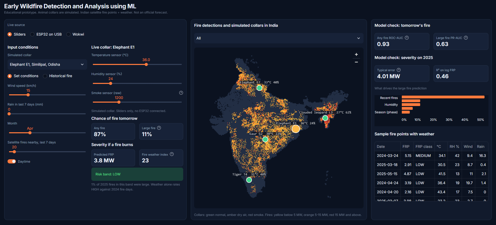
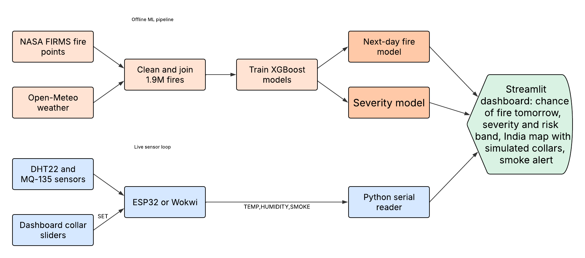
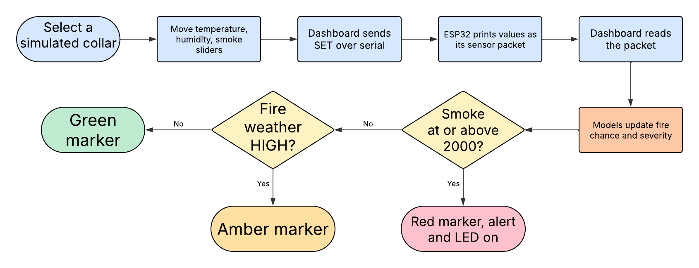

# Early Wildfire Detection and Analysis using ML

Educational prototype by RV College of Engineering students (EL Phase-1). It joins NASA satellite fire detections over India with weather data, predicts next-day fire and fire severity, and shows the results on a live dashboard fed by an ESP32 sensor unit.

**Not an official forecast and not a safety device.** FRP (Fire Radiative Power, in MW) is a satellite intensity proxy, not burned area. The animal collars in the demo are simulated: no real animal carries this hardware.



## Remaining work

- [ ] Test the collar sliders through the new firmware in Wokwi, and measure the sensor-to-screen delay
- [ ] Flash the real ESP32 and wire the DHT22 and MQ-135
- [ ] Calibrate the smoke threshold on the real rig
- [ ] Add a switch for real sensor readings, for a demo with the rig on a toy animal
- [ ] Take rig photos and live demo evidence
- [ ] Verify every citation in the slides
- [ ] Write the final report and conference paper draft

## What it predicts

| Question | Output | Result on held-out data |
|---|---|---|
| Will a fire be detected tomorrow? | Chance of any fire within about 100 km | ROC-AUC 0.93; cell and month average 0.92 |
| Will it be a large fire (15 MW or more)? | Chance of a large fire | PR-AUC 0.63; cell and month average 0.51 |
| How severe would it be if one burns? | Estimated FRP and risk band | Typical error 4.01 MW; median guess 4.72 MW |

The next-day scores use an 80/20 split that holds out whole weeks, because neighbouring days are nearly identical. On the harder check of training on 2024 and testing on 2025, large fire PR-AUC is 0.66 against 0.48. Severity is tested on 1,031,520 fires from 2025: 27.2 % of fires in the HIGH band were large, against 1.1 % in LOW.

**It does not predict harm** such as area burned, damage or injuries, because the data has none of those.

Recent fires are the strongest input. Weather adds a real but smaller signal, so temperature alone moves the predictions only slightly, while very dry air moves them more. The dashboard also shows the Fosberg Fire Weather Index, a published formula that reacts directly to the sensor.

## How it works



In the demo, the dashboard sliders send values to the ESP32, and the ESP32 reports them as its sensor readings:



## Run it

```bash
python -m venv .venv
.venv\Scripts\activate      # Windows
pip install -r requirements.txt
python -m pytest tests -q
streamlit run src/app.py
```

The trained models and a 30,000-row sample are in the repo, so the dashboard needs no download and no sensor. Leave **Live source** on **Sliders**, or see [hardware/README.md](hardware/README.md) for Wokwi, wiring, flashing and calibration.

To rebuild everything from the FIRMS zips:

```bash
python src/data_prep.py
python src/weather_join.py fetch --cells 180   # about 2 hours, resumes if stopped
python src/weather_join.py join
python src/train_weather_model.py
python src/train_occurrence_model.py
python src/map_outline.py
```

## Repository layout

```
data/raw/        NASA FIRMS VIIRS zips
data/            30,000-row fire and weather sample, India map outline
src/             dashboard, data pipeline, model training and prediction, serial reader
models/          trained next-day and severity models with their metrics
hardware/        ESP32 sketch, Wokwi project, demo sensor and wiring guide
tests/           pytest tests
docs/            slides, SDG alignment, diagrams
```

## Data

- **Fires:** NASA FIRMS VIIRS (NOAA-20 and Suomi NPP), 2023-2026, 4,097,001 vegetation fire detections over India. Source: https://firms.modaps.eosdis.nasa.gov/
- **Weather:** Open-Meteo Historical API, hourly, 2024-25, for the 180 busiest 1 degree cells (about 90 % of detections in those years). Source: https://open-meteo.com/
- **Joined data:** 1,910,632 fire points and 130,140 cell-days. The full join is rebuilt locally and is not in the repo.

## Limitations

- Results apply to the busiest fire areas in 2024-25, not all of India.
- A fire means a satellite detection, so small fires and fires under cloud are missed.
- The next-day model mostly forecasts that fire activity continues, so the first fire of a season is harder to predict.
- Each 1 degree cell uses weather from one point, so it is approximate for any single fire.
- Risk bands are relative to this dataset, not an official danger rating.
- The map outline shows where detections fall. It is not an official boundary.
- The ESP32 smoke value is a relative reading from a low-cost sensor.

## SDGs

See [docs/SDG_alignment.md](docs/SDG_alignment.md). The project supports SDG 13 and SDG 15, with SDG 11 and SDG 3 through the sensor unit.

## References

Breiman (2001), *Machine Learning* 45(1); Fosberg (1978), *Weather in wildland fire management: the fire weather index*, Conference on Sierra Nevada Meteorology; Giglio, Schroeder & Justice (2016), *Remote Sensing of Environment* 178; Schroeder et al. (2014), *Remote Sensing of Environment* 143; Wooster et al. (2005), *J. Geophys. Res.* 110, D24311; Jain et al. (2020), *Environmental Reviews* 28(4).
