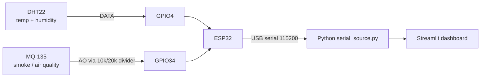

# Early Wildfire Detection and Analysis using ML

Educational prototype. Indian satellite fire points (NASA FIRMS VIIRS) joined with weather (Open-Meteo) to estimate fire intensity, shown in a Streamlit dashboard and fed live by an ESP32 sensor unit. **Not an official forecast and not a safety device.**

> **FRP (Fire Radiative Power, MW) is a satellite intensity proxy. It is not burned area in hectares.**

## Status

| Part | State |
|---|---|
| Datasets in repo (`data/raw`) | done |
| Slides (`docs/EL_Phase1_Wildfire.pptx`) | done |
| Serial parser + ESP32 sketch (`src/serial_source.py`, `hardware/`) | written, parser unit-tested, sketch not yet flashed |
| FIRMS cleaning + quick-look figures | implemented |
| Cached Open-Meteo weather join | implemented; run the full join before training |
| Satellite-only and weather-informed FRP models | implemented; training writes full-data metrics |
| Offline dashboard | implemented; reads the local joined CSV and saved model |
| Hardware build and integration | after the model works |

## Repository layout

```
data/raw/        FIRMS VIIRS zips (tracked); extracted CSVs are git-ignored
data/samples/    one-location Open-Meteo hourly sample (RH only)
data/            firms_india_raw.csv and india_fires_weather.csv (local, ignored)
data/cache/      compressed, resumable Open-Meteo responses (ignored)
src/             app.py  data_prep.py  features.py  model_io.py  quicklook.py  train_model.py  serial_source.py
hardware/        esp32_sensor/esp32_sensor.ino
tests/           pytest tests
evidence/        generated figures, screenshots, photos for the report
docs/            EL_Phase1_Wildfire.pptx
```

## Data

| File | Content |
|---|---|
| `data/raw/DL_FIRE_J1V-C2_834163.zip` | VIIRS NOAA-20 (J1), 375 m. `fire_archive` 2,370,155 rows + `fire_nrt` 32,132 rows |
| `data/raw/DL_FIRE_SV-C2_834164.zip` | VIIRS Suomi NPP (SV), 375 m. `fire_archive` 2,281,841 rows + `fire_nrt` 29,259 rows |
| `data/samples/open-meteo-21.97N78.98E696m.csv` | Hourly relative humidity for one point (21.97 N, 78.98 E), 2023 onward |

The current cleaned file contains 4,713,018 detections from 2023-01-01 through 2026-10-29, inside India's configured box (lat 8.0-35.1, lon 68.5-97.2). Source CSV columns include `latitude, longitude, brightness, scan, track, acq_date, acq_time, satellite, instrument, confidence, version, bright_t31, frp, daynight, type`.

- **Confidence is a letter for VIIRS**: `n` nominal (~79%), `l` low (~18%), `h` high (~2.5%). Map to categories, or drop `l` for cleaner training.
- **FRP is heavily skewed**: median about 3.5 MW, 90th percentile about 11 MW, 99th about 47 MW. Train on `log1p(frp)`.
- `acq_time` is UTC as `HHMM`. India is UTC+5:30.
- Source: NASA FIRMS (https://firms.modaps.eosdis.nasa.gov/). Weather: Open-Meteo Historical API (https://open-meteo.com/), non-commercial free use.

## Software roadmap (do in this order)

Set up once:

```bash
python -m venv .venv && .venv\Scripts\activate      # Windows
pip install -r requirements.txt
python -m pytest tests -q
```

1. **Extract and clean (`src/data_prep.py`)**. `python src/data_prep.py` extracts the FIRMS ZIPs into `data/raw/extracted/`, combines the archive and near-real-time CSVs, keeps usable rows in the India bounds, drops exact duplicates, and writes `data/firms_india_raw.csv` with `lat, lon`.
2. **Quick look first**. Run `python src/quicklook.py` to plot the log-axis FRP histogram, fires per month, and a uniformly sampled scatter map. This creates Figs 5, 6 and 9 before weather work.
3. **Weather join (`src/data_prep.py`)**.
   - Round each point to a 0.25 degree grid cell. Fetch **one hourly series per cell for the whole date range** (`temperature_2m, relative_humidity_2m, wind_speed_10m`) from `https://archive-api.open-meteo.com/v1/archive`, instead of one call per point.
   - Cache each compressed cell response, including request metadata and retrieval time, in `data/cache/`; completed cells are reused after an interruption.
   - Weather requests use UTC to match FIRMS `acq_time`, run at most four requests concurrently, and globally space request starts to stay within the archive service's hourly limit. HTTP 429/5xx responses are retried; an hourly-limit response pauses requests for an hour. The full download may take several hours, and completed cells are reused after an interruption.
   - Start with a few thousand rows, then widen to the full file:
     ```bash
     python src/data_prep.py --weather --max-points 3000 --output data/india_fires_weather_pilot.csv
     python src/data_prep.py --weather --force-weather
     ```
   - The full current file requires weather for 4,568 distinct cells. Allow the full join to finish; it makes thousands of archive requests and caches the results for offline reuse.
   - Each point is matched to the nearest hourly weather observation to its UTC satellite pass. The complete result is `data/india_fires_weather.csv`, including `temp_c, rh_percent, wind_kmh`.
4. **Features (`src/features.py`)**. Inputs: `temp_c, rh_percent, wind_kmh`; optional `month`, `brightness`, `confidence`. Target: `log1p(frp)`. Risk bands: start with LOW below 5 MW, MEDIUM 5-15 MW, HIGH 15 MW and above, then tune from the percentiles above.
5. **Train (`src/train_model.py`, `src/model_io.py`)**. Run `python src/train_model.py` after the weather join. The default uses all valid rows, an 80/20 random split (`random_state=42`), XGBoost with `device="cuda"`, and joblib output under `models/readme_model_training/`. `--max-samples N` is only for experiments; omit it for the full run.
   - Train the README's satellite-only XGBoost and a weather-informed XGBoost using the same 80/20 split. Compare both against a training-median baseline; the dashboard uses the weather-informed model.
   - Report log-FRP MAE/R² and MW MAE. The trainer also evaluates an untouched 2026 time holdout (train 2023-2025) and 3-fold date-grouped cross-validation; cross-validation uses a deterministic 100,000-row sample to keep it practical.
   - CUDA is requested first; if XGBoost reports that CUDA is unavailable, the trainer warns and retries on CPU. The model, metrics, and figures are stored locally; outputs for this training branch do not overwrite the original `models/wildfire_model.joblib`.
   - **Leakage warning**: nearby/same-day detections can be related, so random-split scores may be optimistic. Use the time-based and grouped-date results as additional checks.
   - If weather data is unavailable, an explicit `--allow-no-weather-fallback` option trains the documented `lat, lon, month` model and the dashboard labels it **fallback: no weather**. The full weather-informed run does not silently fall back.
6. **Dashboard (`src/app.py`)**. Run `streamlit run src/app.py` after training.
   - Title: *Early Wildfire Detection and Analysis using ML*. Caption: *Educational prototype. Indian satellite fire points + weather. Not an official forecast.*
   - Left: sliders for temperature, humidity, wind, or pick a historical fire point.
   - Centre: map coloured by FRP band (Fig 9).
   - Right: predicted FRP, risk band, feature importance.
   - Bottom: table of sample fire points with weather.
   - The local chart uses longitude/latitude axes instead of map tiles, so the dashboard itself needs no network access. The model, joined CSV, and weather cache are read from disk; no sensor is required.
7. **Tests (`tests/`)**. Cover the weather-cell rounding, nearest-hour lookup, risk-band thresholds and the model round trip. Run `python -m pytest tests -q` before every commit.
8. **Evidence (`evidence/`)**. Quick-look and training commands save generated figures in `evidence/`. Fig 10 is a real hardware photo and must be taken after the physical ESP32 build; it is not generated by code.

Run the dashboard: `streamlit run src/app.py`. To explicitly train the no-weather fallback instead, use `python src/train_model.py --data data/firms_india_raw.csv --allow-no-weather-fallback`.

## Hardware (build after the model and dashboard work)

Not a safety device: the MQ-135 is a cheap air-quality sensor and the numbers are indicative only. Use it on a demo rig, never to protect people or property.

### Parts

ESP32 DevKit (30 or 38 pin), DHT22 (or AM2302 module), MQ-135 module, two resistors (10 kOhm and 20 kOhm), breadboard, jumper wires, USB data cable.

### Wiring (Fig 4)

| Sensor pin | ESP32 pin | Note |
|---|---|---|
| DHT22 VCC | 3V3 | |
| DHT22 DATA | GPIO4 | 10 kOhm pull-up to 3V3 if you use the bare 4-pin sensor (modules already have it) |
| DHT22 GND | GND | |
| MQ-135 VCC | VIN (5 V) | needs 5 V for its heater |
| MQ-135 GND | GND | |
| MQ-135 AO | 10 kOhm to GPIO34, GPIO34 to GND through 20 kOhm | **voltage divider required**: AO can reach 5 V but the ESP32 ADC tolerates 3.3 V |
| MQ-135 DO | not connected | |



### Firmware

1. Install Arduino IDE, add the ESP32 board package, and install the libraries **DHT sensor library** and **Adafruit Unified Sensor**.
2. Open `hardware/esp32_sensor/esp32_sensor.ino`, choose board *ESP32 Dev Module*, upload.
3. Open Serial Monitor at 115200 baud. Expect a line every 2 s, for example `36.4,24.0,1830`.

### Serial packet

`TEMP,HUMIDITY,SMOKE`, one line per reading: temperature in degrees C, relative humidity in %, smoke as the **raw 12-bit ADC value (0-4095)**. It is a relative index, not ppm. Calibrate by logging clean-air and smoke-exposed readings and choose your own alert threshold.

### Python side

`src/serial_source.py` parses and validates each line (`parse_packet`) and `SerialSource(port).latest()` returns the newest valid reading or `None`. In `app.py`, add a sidebar port selector (`available_ports()`). If a reading arrives, show it in the *Live Sensor* panel and use its temperature and humidity as model inputs (wind stays a slider). If not, use the sliders. Smoke is shown as a live value and alert only, because the model is not trained on smoke.

### Hardware checklist

1. Flash the sketch and confirm the serial monitor output.
2. Let the MQ-135 warm up for several minutes at least (its datasheet recommends a much longer first preheat) before trusting readings.
3. Check DHT22 against a known thermometer.
4. Run `python -c "from src.serial_source import *; s=SerialSource('COM3'); import time; time.sleep(3); print(s.latest())"` with your port.
5. Integrate in the dashboard, unplug the board, confirm it falls back to the sliders.
6. Photograph the rig and screenshot the dashboard with live values (Fig 10).

## Figures

Numbers 1-3 and 4 are already made; 5-10 are produced as the work progresses. Save images in `evidence/`.

| Fig | Where | What it shows | Caption |
|---|---|---|---|
| 1 | Slide 3 | Concept image: a VIIRS satellite scanning India with fire hotspots | A satellite detects fire hotspots over India; each carries an FRP value. |
| 2 | Slide 8 | Architecture. Top lane: offline ML pipeline (FIRMS data, clean, weather join, Random Forest, evaluate, saved model). Middle lane: ESP32 with DHT22 and MQ-135, USB serial packet, Python reader. Bottom lane: dashboard with fire map, predicted FRP and risk band, live sensor panel, slider fallback | System architecture: ML pipeline, ESP32 sensor unit and Streamlit dashboard. |
| 3 | Slide 9 | Dashboard mockup (illustrative values): sliders and live ESP32 panel on the left, India fire map in the centre, predicted FRP, risk band and feature importance on the right, sample fire points table at the bottom | Dashboard layout. |
| 4 | README | Wiring diagram: DHT22 to GPIO4, MQ-135 AO through a 10k/20k divider to GPIO34, USB to PC | ESP32 sensor wiring. |
| 5 | `evidence/fig5_frp_hist.png` | Histogram of FRP on a log axis, showing the long right tail (median ~3.5 MW, p99 ~47 MW) | Distribution of satellite FRP over India. |
| 6 | `evidence/fig6_monthly.png` | Fire count by month, showing the dry-season peak | Seasonality of detections. |
| 7 | `evidence/fig7_pred_vs_actual.png` | Predicted vs actual FRP on the random test set with the y = x line | Model accuracy on held-out data. |
| 8 | `evidence/fig8_importance.png` | Random Forest feature importance for temperature, humidity and wind (up to 100,000 complete rows) | Which weather inputs matter most. |
| 9 | `evidence/fig9_map.png` | Sampled FIRMS detections plotted by location and FRP | Fire detections across India. |
| 10 | `evidence/fig10_rig.jpg` | Photo of the ESP32 rig next to the dashboard showing live values | Hardware integrated with the dashboard. |

## Limitations to state in the report

- Satellites pass a few times a day: no detection does not mean no fire, and clouds block detections.
- Weather comes from a 0.1-0.25 degree reanalysis grid, not from the fire location itself.
- FRP depends on fuel and fire size as well as weather, so weather-only R2 will be modest. Report the baseline gap, not just the score.
- The ESP32 smoke value is a relative index from a low-cost sensor.

## References

Breiman (2001), *Machine Learning* 45(1); Giglio, Schroeder & Justice (2016), *Remote Sensing of Environment* 178; Schroeder et al. (2014), *Remote Sensing of Environment* 143; Wooster et al. (2005), *J. Geophys. Res.* 110, D24311; Jain et al. (2020), *Environmental Reviews* 28(4). Verify each citation before submitting.
